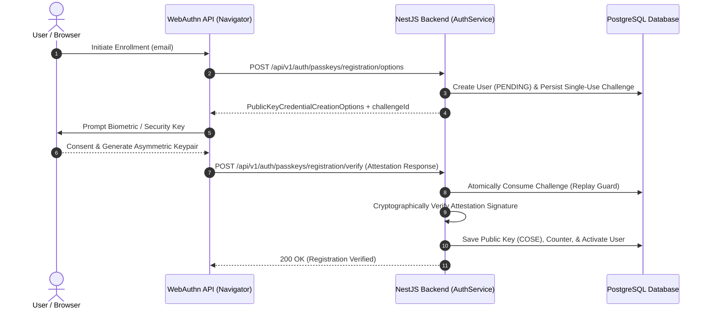
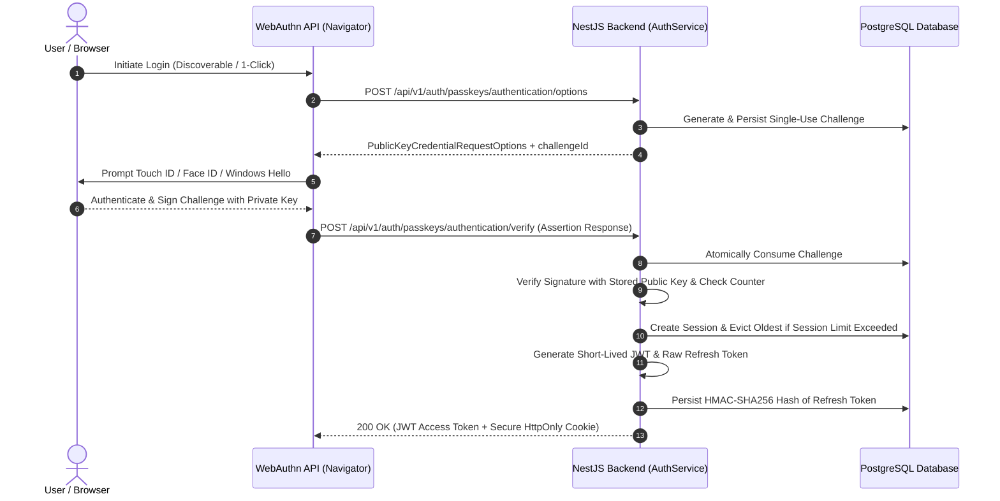
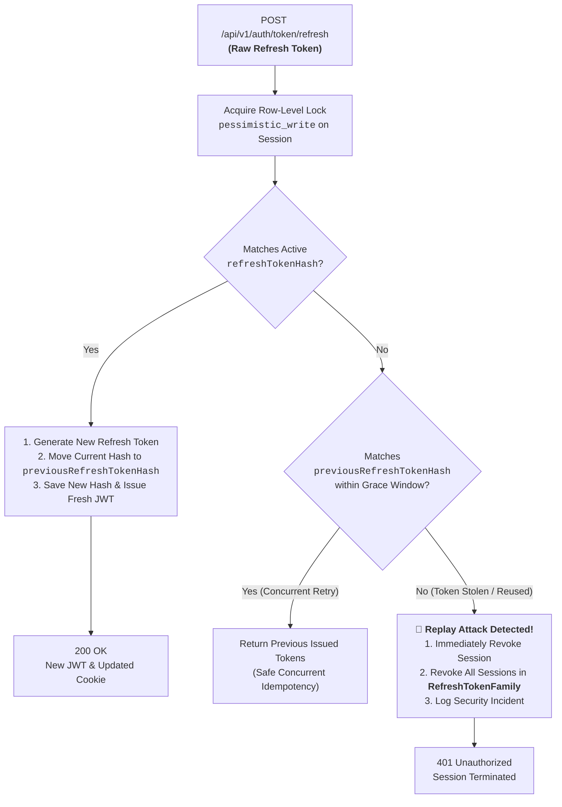

<div align="center">


# 🔑 Passkey Authentication System


### _Production-Grade, Passwordless Authentication Backend_


[](https://nestjs.com/)
[](https://www.typescriptlang.org/)
[](https://fidoalliance.org/)
[](https://www.postgresql.org/)
[](https://nodejs.org/)
[](https://vitest.dev/)
[](https://www.docker.com/)


<p align="center">
  A high-security, scalable, passwordless authentication backend built with <b>NestJS (ESM)</b>, <b>PostgreSQL</b>, and <b>WebAuthn / FIDO2</b> standards.<br>
  Replaces insecure passwords with asymmetric public-key cryptography backed by platform authenticators and hardware security keys.
</p>

<p align="center">
  <a href="#-key-features"><b>Key Features</b></a> •
  <a href="#-why-passkeys"><b>Why Passkeys?</b></a> •
  <a href="#-how-it-works"><b>How It Works</b></a> •
  <a href="#-system-architecture"><b>Architecture</b></a> •
  <a href="#-quick-start"><b>Quick Start</b></a> •
  <a href="#-api-specification"><b>API Docs</b></a> •
  <a href="#-security-architecture"><b>Security Model</b></a>
</p>

---


</div>


## 💡 Why Passkeys?

Traditional password systems are the leading cause of security breaches due to phishing, brute-force attacks, credential stuffing, and server database leaks. Passkeys eliminate shared secrets entirely by leveraging **public-key cryptography** anchored to the client's secure hardware.

| Threat / Feature           | Traditional Passwords                | Passkey Authentication System                               |
| -------------------------- | ------------------------------------ | ----------------------------------------------------------- |
| **Phishing Resistance**    | ❌ Highly vulnerable                 | ✅ **Immune** (bound cryptographically to origin/RP ID)     |
| **Credential Storage**     | ❌ Stored hashes vulnerable to leaks | ✅ **Zero server secrets** (only public keys stored)        |
| **Brute-Force & Stuffing** | ❌ Constant risk                     | ✅ **Mathematically impossible** (256-bit ECDSA/RSA)        |
| **Authenticator Cloning**  | ❌ Easy (reused passwords)           | ✅ **Detected** via monotonic signature counters            |
| **User Experience**        | ❌ Forgotten passwords & resets      | ✅ **1-Click biometric** (Face ID, Touch ID, Windows Hello) |

---


## ✨ Key Features


- 🛡️ **W3C WebAuthn & FIDO2 Level 3 Compliance:** Implemented with `@simplewebauthn/server` for full attestation and assertion ceremony validation.
- 🔐 **Zero Password Footprint:** The application schema contains no password fields, hashes, salts, or reset tokens.
- ⚡ **Enterprise Token Architecture:**
  - **Short-Lived JWT Access Tokens:** 15-minute TTL, pinned to `HS256`, strictly verified for audience (`aud`) and issuer (`iss`).
  - **Opaque Refresh Tokens:** 256-bit cryptographic entropy (`crypto.randomBytes(32)`), stored exclusively as salted **HMAC-SHA256 hashes**.
- 🔄 **Concurrency-Safe Token Rotation:** Database row-level locking (`pessimistic_write`) prevents race conditions during token rotation.
- ⏱️ **Rotation Grace Period:** Supports rapid, concurrent network retries without failing in-flight requests.
- 🚨 **Token Replay / Reuse Detection:** Replaying a previously rotated token triggers instant revocation of the compromised session and its entire **token family**.
- 🚫 **Real-Time Revocation:** `JwtAuthGuard` checks database session validity in real time—logouts and administrative revocations take effect immediately.
- 🍪 **Dual Transport Support:** Secure, cross-site-isolated `HttpOnly` cookies for modern web browsers alongside JSON body transport for mobile and native apps.
- 📱 **Active Session Management:** Per-user concurrent session limits (`MAX_ACTIVE_SESSIONS_PER_USER`) with automated oldest-session eviction.
- 🔍 **Strict Observability:** Structured Pino logging with automatic redaction of cookies, tokens, authorization headers, and challenge payloads.

---


## 🔄 How It Works


### 1. Passkey Registration Ceremony





### 2. Passkey Authentication & Token Issuance



### 3. Concurrency-Safe Refresh Token Rotation & Replay Defense



---

## 🏗️ System Architecture

The application is structured as a modular NestJS monolith with clear separation between identity, credential storage, session management, and authentication ceremonies:

```
passkey-authentication-system/
├── nest-server/                         # Main Backend Workspace
│   ├── src/
│   │   ├── auth/                        # WebAuthn ceremonies & token generation
│   │   │   ├── guards/                  # Real-time session-aware JwtAuthGuard
│   │   │   ├── decorators/              # Type-safe @CurrentUser() decorator
│   │   │   ├── challenge.service.ts     # Atomic challenge lifecycle & replay checks
│   │   │   ├── token.service.ts         # HS256 JWT & HMAC-SHA256 crypto operations
│   │   │   ├── auth.service.ts          # SimpleWebAuthn attestation & assertion logic
│   │   │   └── auth.controller.ts       # Registration & authentication endpoints
│   │   ├── sessions/                    # Enterprise session management
│   │   │   ├── entities/                # Session entity with token hashes & family IDs
│   │   │   ├── sessions.service.ts      # Concurrency-safe rotation & replay detection
│   │   │   └── sessions.controller.ts   # Refresh, logout, and session revocation
│   │   ├── users/                       # User domain model and repository logic
│   │   ├── passkeys/                    # Passkey credential repository & counter tracking
│   │   ├── database/                    # TypeORM DataSource & versioned SQL migrations
│   │   │   └── migrations/              # DDL migrations with cascade constraints
│   │   ├── health/                      # Production liveness & PostgreSQL readiness probes
│   │   ├── logging/                     # Pino structured logger with automated redaction
│   │   ├── common/                      # Constants, DTOs, interfaces & exception filters
│   │   ├── config/                      # Joi-validated environment configuration
│   │   ├── app.module.ts                # Application root aggregator
│   │   └── main.ts                      # Bootstrap, security headers, cookies & Swagger
│   ├── test/                            # Comprehensive E2E test suites (Supertest)
│   ├── Dockerfile                       # Multi-stage production container build
│   └── docker-compose.yml               # PostgreSQL 17 database service
```

---

## 📡 API Specification

Interactive Swagger / OpenAPI 3.0 documentation is available at `http://localhost:3000/api/docs`.

### Authentication & Passkey Ceremonies

| Method | Endpoint                                       | Auth   | Description                                                       |
| ---    | ---                                            | :---:  | ---                                                               |
| `POST` | `/api/v1/auth/passkeys/registration/options`   | Public | Generates WebAuthn registration challenge & options               |
| `POST` | `/api/v1/auth/passkeys/registration/verify`    | Public | Verifies authenticator attestation and registers passkey          |
| `POST` | `/api/v1/auth/passkeys/authentication/options` | Public | Generates assertion challenge (supports discoverable credentials) |
| `POST` | `/api/v1/auth/passkeys/authentication/verify`  | Public | Verifies assertion signature, creates session, returns tokens     |

### Session & Token Management

| Method   | Endpoint                     | Auth           | Description                                                    |
| ---      | ---                          | :---:          | ---                                                            |
| `POST`   | `/api/v1/auth/token/refresh` | Public         | Rotates refresh token (cookie or body) and returns new JWT     |
| `POST`   | `/api/v1/auth/logout`        | `Bearer <JWT>` | Revokes current session and clears refresh token cookie        |
| `POST`   | `/api/v1/auth/logout/all`    | `Bearer <JWT>` | Revokes all active sessions across all devices for user        |
| `GET`    | `/api/v1/auth/sessions`      | `Bearer <JWT>` | Lists user sessions with `isCurrent` flag and safe metadata    |
| `DELETE` | `/api/v1/auth/sessions/:id`  | `Bearer <JWT>` | Revokes a specific active session by UUID                      |

### System Health Probes

| Method | Endpoint               | Auth   | Description                                                    |
| ---    | ---                    | :---:  | ---                                                            |
| `GET`  | `/api/v1/health/live`  | Public | Liveness probe returning process uptime and timestamp          |
| `GET`  | `/api/v1/health/ready` | Public | Readiness probe checking live PostgreSQL database connectivity |

<details>
<summary><b>🔍 Click to view Sample Payloads & Schemas</b></summary>

#### 1. Registration Options Request

```json
POST /api/v1/auth/passkeys/registration/options
Content-Type: application/json

{
  "email": "alice@example.com",
  "displayName": "Alice Smith"
}
```

#### 2. Authentication Verification Response (Success)

```json
HTTP/1.1 200 OK
Set-Cookie: refresh_token=e4c7...; Path=/api/v1/auth; HttpOnly; SameSite=Lax

{
  "verified": true,
  "user": {
    "id": "c1f7b494-0131-4e78-9b87-d4fa7df76f1a",
    "email": "alice@example.com",
    "status": "ACTIVE",
    "emailVerified": false,
    "createdAt": "2026-11-01T20:00:00.000Z"
  },
  "tokens": {
    "accessToken": "eyJhbGciOiJIUzI1NiIsInR5cCI6IkpXVCJ9...",
    "refreshToken": "e4c79872e48fa2409581...",
    "expiresIn": 900,
    "tokenType": "Bearer"
  }
}
```

#### 3. List Active Sessions Response

```json
GET /api/v1/auth/sessions
Authorization: Bearer <accessToken>

[
  {
    "id": "550e8400-e29b-41d4-a716-446655440000",
    "isCurrent": true,
    "deviceLabel": "Chrome on macOS",
    "ipAddress": "192.168.1.100",
    "userAgent": "Mozilla/5.0 (Macintosh; Intel Mac OS X 10_15_7)...",
    "createdAt": "2026-11-01T21:00:00.000Z",
    "lastActivityAt": "2026-11-01T21:15:00.000Z",
    "expiresAt": "2026-11-08T21:00:00.000Z",
    "isRevoked": false
  }
]
```

</details>

---


## 🚀 Quick Start

### Prerequisites

- **Node.js:** v24.x LTS or higher
- **Package Manager:** npm (v10+)
- **Container Engine:** Docker & Docker Compose


### 1. Clone & Setup Workspace

```bash
git clone https://github.com/your-username/passkey-authentication-system.git
cd passkey-authentication-system/nest-server
```


### 2. Configure Environment

```bash
cp .env.example .env
```

> [!NOTE]
> The pre-filled values in `.env.example` are immediately functional for local development.


### 3. Start PostgreSQL Container

```bash
docker compose up -d
```


### 4. Install Dependencies

```bash
npm install
```


### 5. Run TypeORM Migrations

```bash
npm run migration:run
```


### 6. Launch the Development Server

```bash
npm run start:dev
```

   The API will be operational at:

- **Base URL:** `http://localhost:3000`
- **Swagger Documentation:** `http://localhost:3000/api/docs`
- **Health Check:** `http://localhost:3000/api/v1/health/ready`


---


## 🔒 Security Architecture


The system incorporates defense-in-depth principles across every architectural layer:


```
[ Client Request ]
       │
       ▼
┌──────────────────────────────────────────────┐
│  Helmet Security Headers (CSP, HSTS, Sniff)  │
└──────────────────────┬───────────────────────┘
                       ▼
┌──────────────────────────────────────────────┐
│  Throttler Rate Limiting (Brute-Force Guard) │
└──────────────────────┬───────────────────────┘
                       ▼
┌──────────────────────────────────────────────┐
│  CORS Origin Whitelist Validation            │
└──────────────────────┬───────────────────────┘
                       ▼
┌──────────────────────────────────────────────┐
│  Global ValidationPipe (Whitelist & DTOs)    │
└──────────────────────┬───────────────────────┘
                       ▼
┌──────────────────────────────────────────────┐
│  JwtAuthGuard (Real-Time Revocation Check)   │
└──────────────────────┬───────────────────────┘
                       ▼
┌──────────────────────────────────────────────┐
│  TypeORM Transaction (Row-Level Locking)     │
└──────────────────────────────────────────────┘
```


1. **Private Keys Never Leave Authenticators:** Only public keys in COSE format are stored on the server.
2. **Monotonic Counter Verification:** Detects authenticator cloning by verifying signature counters on each assertion ceremony.
3. **HMAC-SHA256 Token Vaulting:** Refresh tokens are never stored raw. A database breach reveals only one-way HMAC hashes.
4. **Timing Attack Immunity:** Hash validation uses Node.js `crypto.timingSafeEqual` across constant-length buffers.
5. **Session Family Revocation:** Detecting an attempt to reuse a rotated token revokes the entire family across all associated devices.
6. **Automatic Sensitive Log Redaction:** Authorization headers, tokens, cookies, and challenges are scrubbed (`[REDACTED]`) before logs reach stdout.


---

## ⚙️ Environment Variables Reference

   | Variable | Description | Default | Allowed Values |
   |---|---|---|---|
   | `PORT` | HTTP port | `3000` | 1–65535 |
   | `NODE_ENV` | Environment mode | `development` | `development`, `production`, `test` |
   | `DATABASE_HOST` | PostgreSQL host | `localhost` | Hostname / IP |
   | `DATABASE_PORT` | PostgreSQL port | `5432` | 1–65535 |
   | `DATABASE_NAME` | Database name | `passkey_auth` | String |
   | `RP_NAME` | WebAuthn Relying Party name | `Passkey Authentication System` | Non-empty string |
   | `RP_ID` | WebAuthn Relying Party domain | `localhost` | FQDN or hostname |
   | `RP_ORIGIN` | Allowed WebAuthn origins | `http://localhost:3000` | Comma-delimited URLs |
   | `CHALLENGE_TTL_MS` | Challenge lifespan in ms | `60000` (60s) | Positive integer |
   | `USER_VERIFICATION` | User verification policy | `preferred` | `preferred`, `required`, `discouraged` |
   | `JWT_ACCESS_SECRET` | Secret for signing JWTs | `dev-jwt-access-secret...` | Min 32 chars |
   | `JWT_ACCESS_TTL` | Access token lifespan | `15m` | Time format (`15m`, `1h`) |
   | `REFRESH_TOKEN_TTL_DAYS` | Refresh token lifespan | `7` | Integer (1–90) |
   | `REFRESH_TOKEN_SECRET` | HMAC salt for refresh tokens | `dev-refresh-token-hmac...` | Min 32 chars |
   | `MAX_ACTIVE_SESSIONS_PER_USER` | Concurrent session cap | `5` | Integer (1–20) |
   | `COOKIE_NAME` | Refresh cookie identifier | `refresh_token` | String |
   | `COOKIE_SECURE` | HTTPS-only cookie flag | `false` (dev) / `true` (prod) | Boolean |
   | `COOKIE_SAME_SITE` | SameSite cookie policy | `lax` | `lax`, `strict`, `none` |

---

## 🧪 Testing & Verification

Unit and E2E tests are built using **Vitest** and **Supertest** natively in ESM:

```bash
# Run unit test suites
npm run test

# Run unit tests with coverage report
npm run test:cov

# Run HTTP integration and E2E suites
npm run test:e2e

# Run Oxlint static analysis
npm run lint

# Format codebase with Prettier
npm run format
```

---

## 📈 Implementation Status

- [x] **Stage 1: Foundation & Architecture** (ESM, NestJS 12, PostgreSQL 17, TypeORM, Pino, Health Probes)
- [x] **Stage 2: Identity & Passkey Authentication** (WebAuthn, `@simplewebauthn/server`, Challenges, Public Keys)
- [x] **Stage 3: Sessions, Tokens & Security** (JWTs, Rotatable Refresh Tokens, Replay Defense, Real-Time Revocation)
- [ ] **Stage 4: Production Features & Hardening** (Profile management, auth rate limiting, security headers)
- [ ] **Stage 5: Testing, Verification & Deployment** (Automated end-to-end verification, production build)

---

## 📄 License

This project is licensed under the terms described in the [LICENSE](LICENSE) file.

<div align="center">
  <sub>Built with ❤️ for modern passwordless application security.</sub>
</div>
